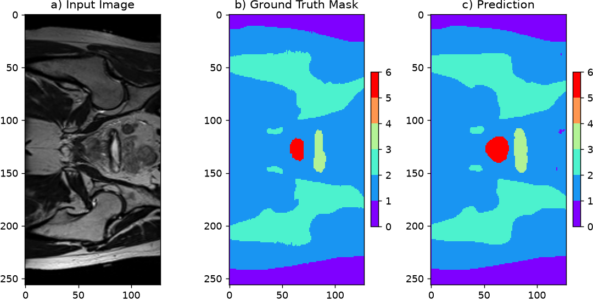

# 3D Improved U-Net for Prostate Segmentation on HipMRI

**Student:** <Name> (<Student ID>)  
**Course:** COMP3710 Pattern Analysis, 2026  
**Project:** Segmentation (HipMRI) — 3D Improved U-Net [Hard Difficulty]  
**Folder:** `recognition/Improved_UNet_<studentID>/`

> Replace every `<...>` placeholder. Delete these instruction blockquotes before submitting.

---

## Table of Contents
1. [Overview](#1-overview)
2. [Feasibility Review](#2-feasibility-review)
3. [How the Algorithm Works](#3-how-the-algorithm-works)
4. [Data and Preprocessing](#4-data-and-preprocessing)
5. [Setup and Reproducibility](#5-setup-and-reproducibility)
6. [Usage](#6-usage)
7. [Results](#7-results)
8. [Investigation of the Open Research Dilemma](#8-investigation-of-the-open-research-dilemma)
9. [Limitations and Future Work](#9-limitations-and-future-work)
10. [Artificial Intelligence Usage Disclosure](#10-artificial-intelligence-usage-disclosure)
11. [References](#11-references)

---

## 1. Overview

> About one paragraph: the problem, why it matters clinically, what your model does.

Prostate radiotherapy planning requires millimetre-level delineation of the prostate while sparing nearby organs at risk (bladder, rectum, femoral heads). This project implements a **3D Improved U-Net** [2] that segments the <body outline, bone, bladder, rectum, prostate> from pelvic MRI volumes in the HipMRI study. It is benchmarked against a <2D U-Net> baseline to investigate whether volumetric context removes boundary errors at the prostate base and apex.


*Figure 1: <Caption — e.g. input, ground truth and prediction overlay.>*

---

## 2. Feasibility Review

> Paste your one-page review from the midpoint check-off. Keep all four parts.

### 2.1 User Need, Scope and Acceptance Criteria
- **Intended user:** <e.g. radiation oncologist reviewing draft contours>
- **Purpose:** <annotation assistant that proposes contours>
- **Acceptance criteria (3–5, testable):**
  1. Prostate Dice ≥ <0.70> on the held-out test set.
  2. <Prostate Dice at base/apex slices ≥ X, or boundary criterion>.
  3. Peak GPU VRAM ≤ <X GB> during training.
  4. Inference time ≤ <X s> per volume.

### 2.2 Model Choice and Course Concepts
<Dataset configuration, architecture, difficulty band, and how course concepts and literature support the choices.>

### 2.3 Preliminary Feasibility Evidence
<Data audit (counts, shapes, class balance), baseline smoke test, measured VRAM estimate.>

### 2.4 Risks, Budget and Fallback
| Risk                       | Mitigation                                            |
|----------------------------|-------------------------------------------------------|
| <GPU memory limits for 3D> | <Downsample / patch-based training / mixed precision> |
| <Severe class imbalance>   | <Dice-based loss>                                     |

- **Compute budget:** <e.g. N GPU-hours on Rangpur>
- **Next experiment:** <...>
- **Fallback:** <e.g. 3D U-Net, or 2D Improved U-Net>

---

## 3. How the Algorithm Works

> Explain the working principles (this is worth 5 marks). Aim for clarity over length.

### 3.1 U-Net Backbone
<Encoder–decoder, skip connections, why they preserve spatial detail.>

### 3.2 Improvements over the Standard U-Net [2]
| Component                           | What it does                                                         | Why it helps here         |
|-------------------------------------|----------------------------------------------------------------------|---------------------------|
| Residual context modules            | <...>                                                                | <...>                     |
| Localisation modules                | <...>                                                                | <...>                     |
| Deep supervision                    | <Segmentation maps at multiple decoder levels, upsampled and summed> | <...>                     |
| Instance normalisation / leaky ReLU | <...>                                                                | <Small batch sizes in 3D> |

### 3.3 3D vs 2D Convolutions
<Inter-slice context vs memory cost. Include a kernel/feature-map size comparison if useful.>

### 3.4 Loss Function
<Equation and justification, e.g. the soft Dice loss:>

$$\mathcal{L}_{Dice} = 1 - \frac{2\sum_i p_i g_i + \epsilon}{\sum_i p_i + \sum_i g_i + \epsilon}$$


*Figure 2: <Architecture of the 3D Improved U-Net.>*

---

## 4. Data and Preprocessing

### 4.1 Dataset
- **Source:** HipMRI Study (`/home/groups/comp3710/HipMRI_Study_open`) — <38 patients, 211 volumes>
- **Labels:** <body outline, bone, bladder, rectum, prostate>
- **Input shape (after downsampling):** `<D x H x W>`
- **Voxel spacing:** `<...>`

### 4.2 Preprocessing
- **Intensity normalisation:** <e.g. per-volume z-score> — <justification and reference>
- **Label encoding:** one-hot, <C> channels
- **Resampling / downsampling:** <method and factor>
- **Augmentation:** <flips, rotations, intensity shifts via ... > — <justification>

### 4.3 Train / Validation / Test Split
| Split      | Patients | Volumes |
|------------|----------|---------|
| Train      | <n>      | <n>     |
| Validation | <n>      | <n>     |
| Test       | <n>      | <n>     |

**Justification:** <Split is by patient, so all volumes from one patient are in a single split. State the ratio, seed, and why.>

---

## 5. Setup and Reproducibility

### 5.1 Dependencies
| Package    | Version |
|------------|---------|
| Python     | 3.14.5  |
| PyTorch    | 2.14.0  |
| ROCM       | 10.1.0  |
| nibabel    | 5.4.2   |
| numpy      | 2.5.2   |
| matplotlib | 3.11.1  |

### 5.2 Reproducibility
- **Random seed:** `<42>`
- **Hardware:** <GPU model, VRAM>
- **Training settings:** optimiser `<...>`, LR `<...>`, batch size `<...>`, epochs `<...>`
- <Note any non-determinism, e.g. cuDNN.>

### 5.3 Repository Structure
```
recognition/Improved_UNet_<studentID>/
├── modules.py    # Model components (PyTorch only, no NumPy)
├── dataset.py    # Data loading, patient-level splits, augmentation
├── train.py      # Training, validation, testing, saving the model
├── predict.py    # Inference and visualisation
├── utils.py      # <Optional helpers: metrics, plotting>
├── images/       # Figures used in this README
└── README.md
```

---

## 6. Usage

```bash
# Train
python train.py --data_dir <path> --epochs <N> --batch_size <B> --save_path <path>

# Predict and visualise
python predict.py --data_dir <path> --weights <path> --out_dir <path>
```

| Argument     | Description           | Default |
|--------------|-----------------------|---------|
| `--data_dir` | <Path to HipMRI data> | <...>   |
| `--epochs`   | <...>                 | <...>   |

**Example input:** <describe a volume and its shape>  
**Example output:** <describe the predicted label volume and files produced>

> Model weights and datasets are **not** committed to the repository.

---

## 7. Results

### 7.1 Training Curves

*Figure 3: <Training and validation loss and Dice per epoch.>*

### 7.2 Example Predictions

*Figure 4: <Input, ground truth and prediction.>*

### 7.3 Test Set Performance
| Class        | Dice      | IoU       |
|--------------|-----------|-----------|
| Body outline | <...>     | <...>     |
| Bone         | <...>     | <...>     |
| Bladder      | <...>     | <...>     |
| Rectum       | <...>     | <...>     |
| **Prostate** | **<...>** | **<...>** |

---

## 8. Investigation of the Open Research Dilemma

> **Question:** Does multi-scale context or true 3D continuity eliminate hazardous boundary and slice-transition errors compared with a standard 2D baseline, or does it only smooth easy central slices at 5–10× the cost?

### 8.1 Baseline
<Describe the baseline model(s): e.g. 2D U-Net, 2D Improved U-Net. State that all models use the **same test patients and metrics**. If 2D predictions are stacked into 3D for scoring, explain how.>

### 8.2 Quantitative Benchmarking
| Model                 | Prostate Dice | Prostate IoU | Bladder Dice | Rectum Dice | <Other> |
|-----------------------|---------------|--------------|--------------|-------------|---------|
| 2D U-Net (baseline)   | <...>         | <...>        | <...>        | <...>       | <...>   |
| 2D Improved U-Net     | <...>         | <...>        | <...>        | <...>       | <...>   |
| **3D Improved U-Net** | <...>         | <...>        | <...>        | <...>       | <...>   |

<Brief interpretation. State whether differences are likely meaningful given the test set size, e.g. report the spread across patients.>

### 8.3 Where Does Context Help? (Slice-wise Analysis)

*Figure 5: Prostate Dice versus slice position (inferior apex → superior base) for each model.*

<Do the models differ at the apex and base compared with the central slices? Discuss empty-slice handling.>

### 8.4 Resource Profiling
| Model             | Parameters | Peak VRAM (GB) | Training time | Inference time / volume |
|-------------------|------------|----------------|---------------|-------------------------|
| 2D U-Net          | <...>      | <...>          | <...>         | <...>                   |
| 2D Improved U-Net | <...>      | <...>          | <...>         | <...>                   |
| 3D Improved U-Net | <...>      | <...>          | <...>         | <...>                   |

### 8.5 Failure Case Autopsy (3–5 cases)

For each case, include the multi-panel figure (image, ground truth, prediction, FP/FN overlay).

#### Case 1: <e.g. prostate apex slice, Patient X>

- **What happened:** <...>
- **Likely trigger:** <e.g. low soft-tissue contrast, partial volume effect>
- **Did the baseline fail too?** <...>

#### Case 2: <...>
<Repeat the same structure for Cases 3–5.>

### 8.6 Recommendation to the Project Manager
- **Does 3D context justify its cost?** <Evidence-based answer.>
- **Where it helps / where it does not:** <...>
- **Cases unsuitable for automated drafting:** <...>
- **Suggested workflow:** <e.g. automate central slices, route base/apex to a human>

---

## 9. Limitations and Future Work
- <Small number of patients, single-centre data, downsampling effects, etc.>
- <Possible extensions.>

---

## 10. Artificial Intelligence Usage Disclosure

| Tool                  | Used for                                         | How I verified the output                                                 |
|-----------------------|--------------------------------------------------|---------------------------------------------------------------------------|
| <e.g. Claude>         | <e.g. explaining theory, debugging shape errors> | <e.g. unit tests on tensor shapes, compared against a hand-computed Dice> |
| <e.g. GitHub Copilot> | <e.g. auto-complete in plotting code>            | <...>                                                                     |

<Be specific. Note any AI suggestions you rejected or corrected.>

---

## 11. References
1. <Baseline / dataset reference [1]>
2. F. Isensee et al., "Brain Tumor Segmentation and Radiomics Survival Prediction: Contribution to the BRATS 2017 Challenge," 2017. <Check the exact reference given in the assignment.>
3. <3D U-Net reference [4]>
4. <Any code, library, or online resource adapted — cite it here and in docstrings.>