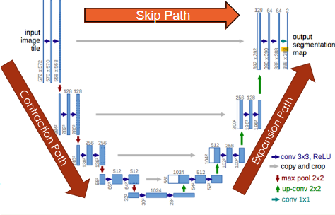
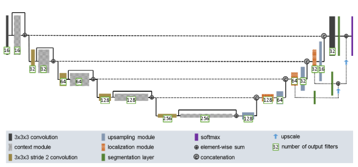
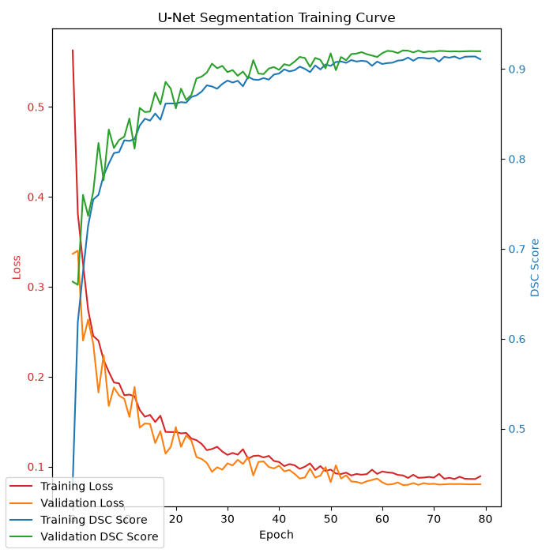
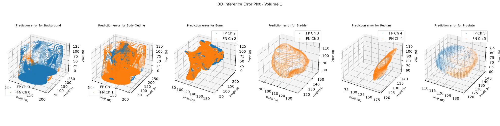

# 3D Improved U-Net for HipMRI Segmentation

**Student ID:** 46482239\
**Course:** COMP3710 Pattern Analysis, 2026\
**Project:** 3D Improved U-Net for HipMRI Segmentation\
**Github:** `recognition/Improved_UNet3D_46482239/`

---

## Table of Contents
1. [Overview](#1-overview)
2. [Feasibility Review](#2-feasibility-review)
3. [How the Algorithm Works](#3-how-the-algorithm-works)
4. [Data and Preprocessing](#4-data-and-preprocessing)
5. [Setup and Reproducibility](#5-setup-and-reproducibility)
6. [Usage](#6-usage)
7. [Results](#7-results)
8. [Investigation of the Open Research Dilemma](#8-investigation-of-the-open-research-dilemma)
9. [Artificial Intelligence Usage Disclosure](#9-generative-ai-disclosure)
10. [References](#10-references)

---

## 1. Overview

Prostate radiotherapy planning requires millimetre-level delineation of the prostate while sparing nearby organs at risk
(bladder, rectum, femoral heads). This project implements a 3D Improved U-Net [2] that segments the background, body 
outline, bone, bladder, rectum, prostate from pelvic MRI volumes in the HipMRI study. It is benchmarked against a 2D 
Improved U-Net with the same kind of residual connections and deep supervision baseline to investigate whether 
volumetric context soothes boundary errors at the prostate base and apex.


*Figure 1: Sample segmentation featuring the (a) input, (b) ground truth, and (c) prediction overlay; produced by the 2D improved U-Net*

---

## 2. Feasibility Review

### 2.1 User Need, Scope and Acceptance Criteria
The model will primarily be targeted towards healthcare professionals, with the main goal being to investigate the 
feasibility of using a 3D automated segmentation model in medical imaging. Specifically, to aid in the identification of 
the prostate in MRI scans. The primary dilemma here is the accuracy trade-off for using 3D scans instead of 2D scans 
since training a 3D segmentation model will up many times more the computation resources.
- **Acceptance criteria (3–5, testable):**
  1. Prostate Dice Score (present) ≥ 0.70 on unseen test set;
  2. Prostate IoU Score (present) ≥ 0.70 on unseen test set;
  3. Peak GPU VRAM allocation ≤ 35 GiB during training;
  4. Inference time ≤ 1 s per volume on A100;
  5. No data leaks by ensuring patient-level splits. We can gauge this using ‘assert’ in code.

### 2.2 Model Choice and Course Concepts
The dataset will be split at the patient-level, and we will separate the data into a training set, validation set, and 
test set with the following weights of 0.80, 0.08, 0.12 (or similar). As an initial model, we will take inspiration from
<___67876> and use a 3D Improved U-Net with residual blocks and deep supervision and choose LeakyReLU and InstanceNorm 
units in the residual blocks. Four (encoder & decoder) layers will be implemented, and we will use 2-layer deep 
supervision. Dice-CE loss will be the basic loss function, and Tversky-CE loss can be considered if more suitable. We 
can implement the base U-Net in accordance with the example shown in week 7/8 of COMP3710. We will compare the 
performance to a 2D Improved U-Net with the same residual blocks and deep supervision.

### 2.3 Preliminary Feasibility Evidence
Initial data audit yields the following information shown. Data is compatible, consistent, and can be split at a patient
level.

*Table 1: Prelimnary data audit*

| Item                         | Description                                                                                                |
|------------------------------|------------------------------------------------------------------------------------------------------------|
| Total Scans                  | 211                                                                                                        |
| Patient Count                | 38                                                                                                         |
| Image Dimensions/shape       | All scans are `(256, 256, 128)` in $H$, $W$, $D$                                                           |
| Patient ID format            | All file names are in the format of `LNNN_WeekX_LFOV/SEMANTIC.nii.gz`<br/>Ex. `B010_Week3_SEMANTIC.nii.gz` |
| 2D Improved U-Net VRAM usage | 1.67 GB                                                                                                    |


### 2.4 Risks, Budget and Fallback
*Table 2: risks and constraints*

| Risk                   | Mitigation                                                                                                   |
|------------------------|--------------------------------------------------------------------------------------------------------------|
| OOM (VRAM)             | Random patch in sizing `__get_item__`; Mixed precision; Small batch size; Load tensor only in `__get_item__` |
| Class imbalance        | Dice Loss + Cross Entropy Loss in training                                                                   |
| Exorbant training time | 2D Improved U-Net is available and working                                                                   |

---

## 3. Network Architecture

### 3.1 U-Net Backbone
Simply put, a U-Net is an autoencoder-like network. But, unlike autoencoders, U-Nets are supervised and feature
skip connections that transfer information between the encoder and the decoder of the same resolution. This skip 
connection is what mitigates the loss of information (preserves spatial detail) as it gets downsampled in the encoders 
and passes through the (bottleneck) latent layer.

\

*Figure 2: Architecture of a U-Net*

The role of the encoder is to extract abstract features of an input. In the middle, the bottleneck holds the most abstract, highest-
channel representation while still retaining spatial structure. The decoder takes the data from this latent 
layer and progressively upsamples it to the original input-resolution while also attempting to produce a per-pixel class 
prediction. At each level, the encoder feature map of matching resolution is concatenated onto the decoder’s feature 
map, which restores the fine spatial detail lost during downsampling. Unlike an autoencoder, which reconstructs its 
input, a U-Net outputs $K$ channels (one per class) via a final 1×1 convolution. Then, a softmax over these channels 
gives us the per-pixel class probabilities, and taking the argmax yields the segmentation mask (akin to a silhouette) of
the every object in the original input.

### 3.2 Improvements over the Standard U-Net
Table 3 lists the main difference between a standard U-Net and an improved U-Net that implements residual blocks, 
accompanied by an illustration featured in Figure 3 below.

*Table 3: Differences between a standard U-Net and Improved U-Net*

| Component              | Function                                                                                                                                      | Why it helps here                                                                                                                                                                                                                   |
|------------------------|-----------------------------------------------------------------------------------------------------------------------------------------------|-------------------------------------------------------------------------------------------------------------------------------------------------------------------------------------------------------------------------------------|
| Residual modules       | Adds two 3x3 convolution blocks with a shortcut added to the block's output; acts as a skip connection between each encoder/decoder           | Allows the network to only have to learn the difference before and after each block rather than across the entire network.<br/>Resolves the vanishing gradient problem; better results when training.                               |
| Deep supervision       | Segmentation maps (1×1 conv) are taken from several decoder levels, upsampled to a common size and summed element-wise into the final output. | The loss gradient reaches the earlier decoder layers through a short path, so training converges faster and vanishing gradients are reduced. It also forces intermediate features to be useful for segmentation at multiple scales. |
| leaky ReLU             | Introduces a small slope on the negative side.                                                                                                | Ensures a small gradient still flows back during backpropagation; doesn't kill neurons.                                                                                                                                             |
| Instance normalisation | normalises each channel of each sample independently across its spatial dimensions.                                                           | Allows for smaller batch sizes to save on VRAM usage since its outputs don’t depend on the batch                                                                                                                                    |


\

*Figure 3: Architecture of an improved U-Net [2]*

### 3.3 Loss Function
In an image segmentation task, we want the model to make accurate predictions on both at pixel-level and general-level.
For other models where we have similar goals, Cross Entropy Loss is usually the standard loss function for its ability 
to perform pixel classifications with the softmax function. However, for datasets with sever imbalance, CE by itself may 
plunder the model by learning to just predict the dominant class. To mitigate this, we introduce the Dice Similarity
Coefficient (DSC). This is because DSC calculates the overlap between the predicted segmentation and the ground truth, 
and focuses on the intersection over union of the specific classes rather than raw pixel counts. Consequently, this is
what makes it a suitable choice for datasets (like the HipMRI) with class imbalance.
The equations for DSC, Dice Loss, and CE are as follows: 
$$\text{DSC}_c = \frac{2 \sum_{i=1}^{N} y_{i,c} \hat{y}_{i,c} + \epsilon}{\sum_{i=1}^{N} y_{i,c} + \sum_{i=1}^{N} \hat{y}_{i,c} + \epsilon}$$
$$\mathcal{L}_{DSC} = 1 - \frac{1}{C} \sum_{c=1}^{C} \text{DSC}_c$$
$$\mathcal{L}_{CE} = - \sum_{i=1}^{N} \sum_{c=1}^{C} y_{i,c} \log(\hat{y}_{i,c})$$
Implementation of these loss functions can be found in modules.py


---

## 4. Data and Preprocessing

### 4.1 Dataset
- **Source:** HipMRI Study (on rangpur:`/home/groups/comp3710/HipMRI_Study_open`) — 38 patients, 211 volumes
- **Labels:** `0: background, 1: body outline, 2: bone, 3: bladder, 4: rectum, 5: prostate`
- **Input shape:** Shape of `(256, 256, 128)` with dimensions $H$, $W$, $D$ 
- **Volume size:** $\text{~}256 \text{ MB}$ depending of precision
  - Made up of `256x256x128`voxels ($8,388,608\text{ voxels}$)
  - Each volume loaded into float32 tensors/arrays $32\times 8,388,608=256 \text{ MB}$
  - For training, we take sub-voxels (patches) of the 3D scan to save on memory cost. The specific ratios is assigned to the `PATCH` variable in the `HipMRI3DDataset` class in `dataset.py`

### 4.2 Preprocessing
- **Splits:** Patient level splits according to the proportions listed in section 4.3
- **Label encoding:** One-hot with 6 channels (labels)
- **Resampling / downsampling:** 2D scans are cropped to `256x128` when necessary
- **Data loading:** The 3D `.nii.gz` files were converted to `.npy` files (under `./processed_npy/`) to speed up data loading during training and inference

### 4.3 Train / Validation / Test Split
A total of 211 scans across 38 patients was provided.

*Table 4: Split proportions of the 3D dataset*

| Split      | Patients | Volumes | Proportion |
|------------|----------|---------|------------|
| Train      | 32       | 191     | 0.9052     |
| Validation | 4        | 11      | 0.0521     |
| Test       | 2        | 9       | 0.0427     |

The data is split in accordance to the ratios defined by the 2D MRI scans below:
- **Train:** $11,460 / 12,660 \approx 90.52\%$
- **Validate:** $660 / 12,660 \approx 5.21\%$
- **Test:** $540 / 12,660 \approx 4.27\%$

---

## 5. Setup

### 5.1 Dependencies
| Package    | Version |
|------------|---------|
| Python     | 3.14.5  |
| PyTorch    | 2.14.0  |
| ROCM       | 10.1.0  |
| nibabel    | 5.4.2   |
| numpy      | 2.5.2   |
| matplotlib | 3.11.1  |

### 5.2 Reproducibility
- **Random seed:** Where relevant, a `seed` of `67` was set for all stochastic processes on import for reproducibility.
  - `torch.manual_seed(seed)` 
  - `np.random.seed(seed)`
  - `random.seed(seed)`
  - `torch.cuda.manual_seed(seed)`
- **Hardware:** Nvidia A100 on rangpur
- **Training settings**
  - ***2D Improved U-Net:***
    - `batch_size = 75`
    - `num_epochs = 40`
    - `dropout = 0.23`
    - `learning_rate = 0.001`
    - `optimiser = torch.optim.Adam`
    - `scheduler = torch.optim.lr_scheduler.CosineAnnealingLR(T_max=num_epochs, eta_min=7e-5)`
  - ***3D Improved U-Net:***
    - `batch_size = 3`
    - `num_epochs = 80`
    - `dropout = 0.31`
    - `learning_rate = 0.0001`
    - `optimiser = torch.optim.Adam`
    - `scheduler = torch.optim.lr_scheduler.CosineAnnealingLR(T_max=num_epochs, eta_min=1.2e-5)`

### 5.3 Repository Structure
```
recognition/Improved_UNet3D_46482239/
├── modules.py      # Model definitions and loss functions
├── dataset.py      # Data preprocessing, data loading, patient-level splits
├── train.py        # Training, validation, and saving the model
├── predict.py      # Inference and visualisation
├── utils.py        # Data audit, plotting helpers, and report helpers
├── images/         # Figures used in this README and from inference
└── README.md
```

---

## 6. Usage

```bash
# Train
python train.py --model <"3D" or "2D"> --epochs <N>

# Predict and run inference
# Assumes .pth exists under <file>
python predict.py --model <"3D" or "2D">
```

| Argument   | Description                   | Default |
|------------|-------------------------------|---------|
| `--model`  | 2D or 3D Improved U-Net       | None    |
| `--epochs` | Number of epochs to train for | 80      |

---

## 7. Results

### 7.1 Training Curves



*Figure 4: Training and validation DiceCE loss and DiceCE scores per epoch*

Throughout the whole training segment, Figure 4 shows that both the validation and training curves exhibited erratic 
behaviour, with both eventually soothing out near the end. Such behaviour is indicative of a learning rate higher than what is suitable. This 
is supported by the shape of the curves at the end, where the `CosineAnnealingLRScheduler` has reduced the learning rate
to a comparatively smaller value of 1.2e-5. Pairing this with the smoothing curves near the end confirms this theory.
Moreover, if we examine the training and validation loss and Dice Scores (DSC) in Figure 4 again, we actually find that 
the mean losses from the validation set is consistently below that of the training lost for the entire training segment.
Initial inspection may lead us to believe that this phenomenon is a good sign; during training we employed patch scaling
on the training dataset that may reduce the volume shy of 30% of the original size, and we also used a relatively high 
dropout of 31%. The training parameters forced the network to learn from volumes where the foreground and 
organ locations vary with every volume. Conversely, during validation we fed the network whole consistent volumes, which could 
be why the training losses are consistently marginally higher.

### 7.2 Example Predictions
Figure 5 illustrates the predictions for volume 1 of the test set, where it produced a scatter of the points in the 3D 
scan that was wrongly predicted. It is immediately clear (from Figure 5), that the majority of errors in predictions lie 
on the boundaries of each class, for it is where the scan outlines from the raw files may be murky; the error points 
produce a silhouette of the class.




*Figure 5: False positives and false negatives for each class for volume 1 (not to scale)*

Likewise, a more intuitive visualisation can be seen below in.

### 7.3 Test Set Performance
*Table 6: Inference results with unseen test set*

| Class        | Dice Score | Dice Score<br/>(Present) | Dice Score<br/>(Pooled) | IoU<br/>(Pooled) | FPR    | FNR    | Precision | Recall |
|--------------|------------|--------------------------|-------------------------|------------------|--------|--------|-----------|--------|
| Background   | 0.995      | 0.995                    | 0.995                   | 0.990            | 0.0005 | 0.0099 | 0.9997    | 0.9901 |
| Body outline | 0.980      | 0.980                    | 0.980                   | 0.961            | 0.0124 | 0.0169 | 0.9769    | 0.9831 |
| Bone         | 0.916      | 0.916                    | 0.917                   | 0.846            | 0.0049 | 0.0491 | 0.8849    | 0.9509 |
| Bladder      | 0.925      | 0.825                    | 0.836                   | 0.883            | 0.0006 | 0.0069 | 0.8883    | 0.9931 |
| Rectum       | 0.832      | 0.832                    | 0.836                   | 0.718            | 0.0003 | 0.1363 | 0.8092    | 0.8637 |
| **Prostate** | 0.833      | 0.833                    | 0.833                   | 0.714            | 0.0002 | 0.1249 | 0.7955    | 0.8751 |


The scores in Table 6 resolves the disparity introduced in section 7.1, where we saw in Figure 4 that the validation 
loss curve consistently sat below the training curve. Underfitting was also a possible reason, but Table 6 confirm that our network
is in fact learning to an adequate standard.

The aggregate dice scores are the dice scores across all slices, including the slices where the class of interest is
absent; it includes the dice scores that predict the empty slices for the said class. On the other hand, the 
'pooled' dice scores consider the aggregate scores across all the slices where the class of interest is present in the 
ground truth mask. Likewise, the 'present' dice score is a mean of the dice scores of the slices where the class of
interest is present in the ground truth masks.

Immediately, it can be said that the dice scores in the 3D network was more consistent. This is to be expected since our 
test volumes all featured the complete anatomy of the hip in one tensor, which means that we expect the dice scores 
across the whole volume to be consistent. Moving on to the other metrics, we can see in Table 6 that the FPR is
exceptionally small, but this may primarily be due to the excessive voxels that is taken up by the foreground. Similarly,
the FNR provides a clearer insight. We can tell from the FNR (and Recall) that our network is able to accurately predict
the voxels in the ground truth over 87% of the time. Conversely, the precision score tells us that our network may have 
trouble distinguishing smaller organs (like the prostate) with unclear boundaries against other classes. At times, it 
can be suspected that the network would 'pad' the segmentation of the prosate -- i.e. predict that the silhouette is 
slightly larger than the ground truth, which makes it falsly predict the borders of an adjacent class is part of the 
prostate.

Overall, our network seems to have produced commendable results, and we have met the requirement of achieving dice scores
greater than 0.7.

---

## 8. Investigation of the Open Research Dilemma

> **Question:** Does multi-scale context or true 3D continuity eliminate hazardous boundary and slice-transition errors compared with a standard 2D baseline, or does it only smooth easy central slices at 5–10× the cost?

### 8.1 Baseline
The base model is a 2D improved U-Net with the same kind of residual connections and deep supervision.

### 8.2 Benchmark Against Base Model
*Table 7: Inference results against baseline*

| Model                 | Dice Score | Dice Score (present) | Dice Score<br/>(pooled) | IoU<br/>(pooled) | FPR    | FNR    | Precision | Recall |
|-----------------------|------------|----------------------|-------------------------|------------------|--------|--------|-----------|--------|
| 2D Improved U-Net     | 0.905      | 0.762                | 0.867                   | 0.766            | 0.0006 | 0.0986 | 0.8357    | 0.9014 |
| **3D Improved U-Net** | 0.833      | 0.833                | 0.833                   | 0.714            | 0.0002 | 0.1249 | 0.7955    | 0.8751 |

Table 7 compares the dice scores from the 3D variant of the improved U-Net to the 2D version. In section 7.3, an 
explanation to why the dice scores for the 3D test set was more or less similar was given. Conversely, for the 2D 
network, the scans were separated into slices along the depth (apex to base), which meant that the prostate was absent 
on many slices. It is expected that such inconsistencies will create a bias where the network will be more inclined to 
predict classes that hold a greater presence across the whole set. Hence, it would be expected that even on slices where
the prostate is present in the ground truth, the network would still hold this bias in the predictions. This would
explain the sudden drop in dice score when we filter out masks that don't contain the prostate. On the other hand, we can
see in Table 7 that the 2D network has a better precision and recall. The 2D network was able to accurately predict over
90% of the prostate corresponding ground truth. However, seeing that the dice score on present slices is considerably 
lower than the precision and recall, it suggests that the  precision and recall for the 2D network are slightly inflated
by the background. Comparing this to the 3D network, where the metrics are more consistent throughout, it leads us to 
believe that the 3D model can provide a better segmentation.

### 8.3 Where Does Context Help? (Slice-wise Analysis)

*Figure 5: Prostate Dice versus slice position (inferior apex → superior base) for each model.*

<Do the models differ at the apex and base compared with the central slices? Discuss empty-slice handling.>

### 8.4 Resource Profiling
*Table 7: Resource usage during training*

| Model             | Parameters | Approx size in FP32 (MB) | Peak VRAM Allocated (GB) | Peak VRAM Reserved (GB) | Training time | Mean Inference time   |
|-------------------|------------|--------------------------|--------------------------|-------------------------|---------------|-----------------------|
| 2D Improved U-Net | 2,055,186  | 7.84                     | 1.67                     | 2.15                    | ~20 mins      | 40 ms / batch (of 42) |
| 3D Improved U-Net | 5,944,914  | 22.68                    | 16.14                    | 22.82                   | ~76 mins      | 140 ms  / volume      |

For both the 2D and 3D architecture, we used four encoders and decoders, each with two `size=3`convolution blocks and a
`size=1` shortcut. Combine this with the same in/out channels for each resolution layer, the only variable becomes the 
dimensionality of the model.

### 8.5 Failure Case Autopsy (3–5 cases)

(prostate base and apex slices, small disconnected
artifacts). Advise your manager which anatomical cases remain unsuitable for automated drafting.
For each case, include the multi-panel figure (image, ground truth, prediction, FP/FN overlay).

#### Case 1: <e.g. prostate apex slice, Patient X>

- **What happened:** <...>
- **Likely trigger:** <e.g. low soft-tissue contrast, partial volume effect>
- **Did the baseline fail too?** <...>

#### Case 2: <...>
<Repeat the same structure for Cases 3–5.>

### 8.6 Recommendation to the Project Manager
- **Does 3D context justify its cost?** <Evidence-based answer.>
- **Where it helps / where it does not:** <...>
- **Cases unsuitable for automated drafting:** <...>
- **Suggested workflow:** <e.g. automate central slices, route base/apex to a human>

---

## 9. Generative AI Disclosure
*Table 8: GenAI disclosure*

| Tool              | Used for                             | Verification Processes                                                                                   |
|:------------------|--------------------------------------|----------------------------------------------------------------------------------------------------------|
| Claude Sonnet 5.5 | Explaining theory                    | Cross-reference with course material and other sources                                                   |
| ...               | Subset-sum problem for patient split | Manual checks on split patient lists using pycharm's debug mode and asserts to detect duplicate patients |
| ...               | Debugging OOM                        | Check training graph and inference results to ascertain the plausibility of results                      |
| ...               | Debugging stdout buffering           | `cat log.out` and `cat log.err` to ensure training is happening                                          |
| ...               | Report template                      | Cross-check with task sheet                                                                              |

---

## 10. References
1. <Baseline / dataset reference [1]>
2. F. Isensee et al., "Brain Tumor Segmentation and Radiomics Survival Prediction: Contribution to the BRATS 2017 Challenge," 2017. <Check the exact reference given in the assignment.>
3. <3D U-Net reference [4]>
4. <Any code, library, or online resource adapted — cite it here and in docstrings.>